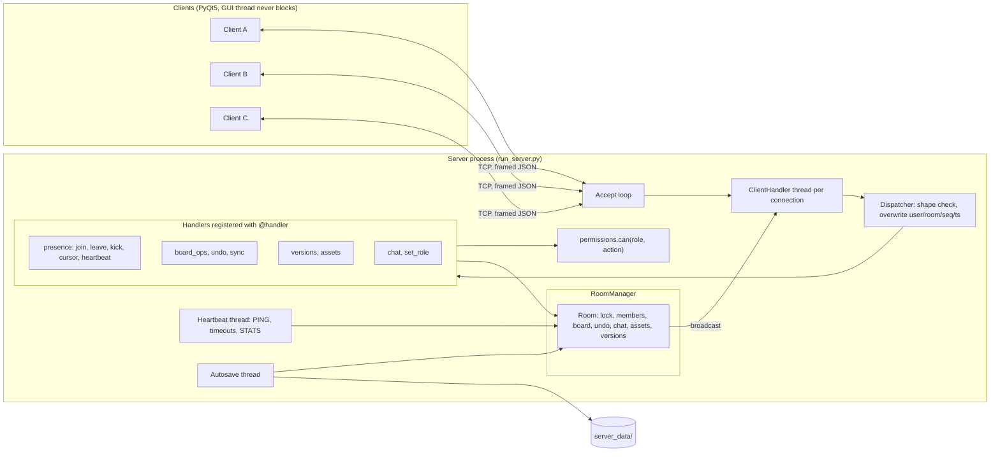
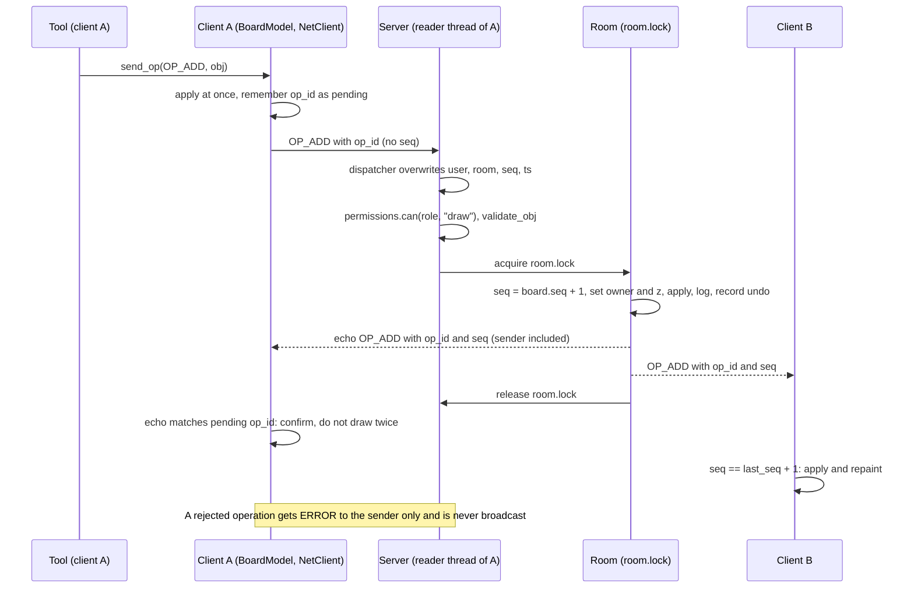

# LAN Whiteboard

A LAN-only, multi-user collaborative whiteboard. Written in Python 3.10+ with PyQt5 and plain TCP sockets (`socket` + `threading`), and it needs no internet connection at run time.
Several people on the same network (for example a phone hotspot) draw, write and chat on one shared board in real time.
Computer Networks lab project, IIITDM Kancheepuram, November 2026.

## Table of contents

1. [Screenshots](#screenshots)
2. [Features](#features)
3. [How it works](#how-it-works)
4. [Protocol](#protocol)
5. [Reliability](#reliability)
6. [Roles and security](#roles-and-security)
7. [Requirements and install](#requirements-and-install)
8. [Quick start from source](#quick-start-from-source)
9. [Using the executables](#using-the-executables)
10. [Using the app](#using-the-app)
11. [Configuration](#configuration)
12. [Project structure](#project-structure)
13. [Testing](#testing)
14. [Building executables](#building-executables)
15. [Troubleshooting](#troubleshooting)
16. [Known limitations](#known-limitations)
17. [Team](#team)
18. [License](#license)

## Screenshots


*The main window in the dark theme: tool rail on the left, canvas in the middle, users and chat on the right, history and statistics at the bottom.*


*The start-up dialog: host a new room or join an existing one.*


*A viewer sees the board but cannot draw: the "View only" banner is shown and the tools are disabled.*


*The host changes the role of each user in Session > Manage roles.*


*The History panel lists the saved versions of the room, with Save, Restore, Rename and Delete.*


*The Latency and traffic panel: round-trip time per user and message and byte counters.*

## Features

### Core features

| Area | What the app does |
|---|---|
| Rooms | One user hosts a room and gets a 6-character room code; others join with the server IP and the code. A room can have a password. The join screen can list the rooms the server knows. |
| Live drawing | Pen, marker, highlighter, object eraser, line, arrow, rectangle, ellipse. Strokes are streamed while they are drawn. |
| Objects | Select, move, resize (one object), multi-select, delete, nudge with the arrow keys. Text boxes, sticky notes and images. |
| Consistent board | The server numbers every accepted operation (`seq`) under the room lock and echoes it to everybody. Clients apply operations in order, buffer gaps and repair them with `SYNC_REQUEST`. |
| Roles | Host, editor and viewer. Every action is checked on the server with `permissions.can(role, action)`. |
| Chat | A room chat and private messages (DM) between two online users. |
| Presence | User list with colours and roles, live cursors with names, join and leave notices. |
| Undo and redo | Per user. The server answers with ordinary inverse operations, so the clients need no undo logic. |
| Versions | Named versions of the board: save, restore, rename, delete. The server also saves automatic versions. |
| Persistence | The server autosaves every room to `server_data/`. A restarted server loads the rooms again. |
| Connection reliability | Heartbeat (PING/PONG), automatic reconnect with a token, `SYNC_DELTA` or `SNAPSHOT` to catch up. |
| Export | The board as JSON (save and load), PNG and PDF. |
| Packaging | One-file executables for Windows and Linux built with PyInstaller. |

### Extras

| Feature | Notes |
|---|---|
| Command bar | Press `/` and type commands such as `rect 100,100 400,200` (see [Using the app](#using-the-app)). |
| Grid and snap | `G` toggles the grid and snap-to-grid together; zoom 10 % to 800 %, pan with Space or the middle mouse button. |
| Text formatting | Font, size, colour, bold, italic, underline, alignment; sticky-note background colours. |
| Latency and traffic panel | Round-trip time per user (measured by the server) and message and byte counters, with a 60-second graph. |
| Board checksum | The History panel footer and Debug > Show board checksum show a checksum of the board; equal checksums on two clients at the same `seq` show that their boards are identical. |
| Light and dark theme | Chosen in View > Toggle dark theme or with the top-bar button; remembered between runs. |
| Collapsible panels | Tool rail, side panel and bottom panel can be collapsed (`Ctrl+1`, `Ctrl+2`, `Ctrl+3`); Users and Chat fold from their headers. |
| Toasts and sounds | Notices for joins, leaves, errors and reconnects; a short chime on join and leave (View > Mute sounds). |
| Kick | The host can remove a user (right-click the user). |
| Room list | The join screen refreshes the list of rooms every 5 seconds. |
| Per-tool pen memory | Each drawing tool remembers its own colour and width. |
| Lossy-network demo | `WB_DROP_PCT` and `WB_DUP_PCT` make a client drop or duplicate incoming operations to demonstrate recovery. |
| Helper scripts | `scripts/check_lan.py` (can this PC reach the server?), `scripts/terminal_client.py` (raw protocol client), `scripts/role_attack.py` (hostile client), `scripts/open_firewall.ps1`. |
| Test suite | 17 test scripts, a UI smoke test and an executable smoke test (see [Testing](#testing)). |

## How it works

One server process holds all rooms. Every client opens one TCP connection to it. The server runs one thread per connection; each thread reads frames and passes them to the dispatcher, which calls the handler registered for the message type.



### One drawing operation



The broadcast happens inside the lock, so the order of frames on the wire equals the `seq` order.

### Why TCP

TCP gives a reliable, ordered byte stream, which is what a shared board needs: operations arrive complete and in the order they were sent on a connection. Because TCP is a stream and not a sequence of messages, every message is wrapped in a length-prefixed frame (see [Protocol](#protocol)). The application adds its own `seq` numbers only to repair gaps that appear when a connection drops and the client reconnects. No datagram traffic is used between client and server; the only UDP socket in the code is in `common/netinfo.py`, which uses it to ask the operating system which local address it would use (no packet is sent). There is no automatic server discovery: users type the server IP.

## Protocol

### Framing

Every message is one frame:

```
+-------------------------------+--------------------------------+
| 4 bytes: N, big-endian uint32 | N bytes: UTF-8 encoded JSON    |
+-------------------------------+--------------------------------+
```

* `common/framing.py` reads exactly 4 bytes, then exactly N bytes (both reads loop, because `recv` may return less).
* `MAX_FRAME` is 8 MiB (8,388,608 bytes). A header announcing more is a protocol error and the connection is closed; the length is checked before any buffer is allocated. Sending a larger message raises an error as well.
* The body must be a JSON object. Invalid UTF-8 or JSON, or a connection closed in the middle of a frame, is a protocol error.
* `send_msg` holds a per-socket lock, so frames written by different threads never interleave.
* Every frame, header included, is counted in `framing.STATS` for the statistics panel.

### Envelope

```json
{"v":1, "type":"OP_ADD", "room":"K7QX2M", "user":"alice", "op_id":"alice-41",
 "seq":null, "ts":0.0, "payload":{}}
```

| Field | Meaning | Set by |
|---|---|---|
| `v` | Envelope version, always 1 | client and server |
| `type` | One of the message types below | sender |
| `room` | 6-character room code (letters A-Z and digits 2-9, without 0, O, 1, I) | overwritten by the server on every received message; the server also stamps it on every message it sends |
| `user` | Name of the sender | **overwritten by the server** with the authenticated name |
| `op_id` | `<user>-<counter>`, on every message that changes the board; used for de-duplication and to match the echo | client |
| `seq` | Per-room counter, starts at 1, +1 per accepted board operation | **server only** (a client value is discarded) |
| `ts` | Server time in epoch seconds | **overwritten by the server** (stamped on every message it sends) |
| `payload` | Object with the fields of the message type | sender |

When the dispatcher receives a frame it checks that it is an object with a string `type` and an object `payload` (otherwise `ERROR BAD_FORMAT`), then overwrites `user`, `room`, `seq` and `ts` before the handler runs. A connection that has not joined a room may only send `CREATE_ROOM`, `JOIN_ROOM`, `PONG` and `ROOM_LIST_REQUEST`; anything else gets `ERROR NO_ROOM`.

Errors are `ERROR {code, text, ref_type}`, sent to the sender only. Codes: `BAD_FORMAT`, `NO_ROOM`, `BAD_PASSWORD`, `NAME_TAKEN`, `FORBIDDEN`, `TOO_LARGE`, `NOT_FOUND`.

### Message types

All 40 types defined in `common/protocol.py`. "C to S" means client to server, "S to C" server to client.

| Type | Direction | Payload | Purpose |
|---|---|---|---|
| `CREATE_ROOM` | C to S | `{username, password?}` | Create a room; the sender becomes host. Answered with `JOIN_OK`. |
| `JOIN_ROOM` | C to S | `{room, username, password?, token?, last_seq?}` | Join a room. `token` and `last_seq` are sent only when reconnecting. |
| `JOIN_OK` | S to C | `{room, token, role, color, users}` | Join accepted. The token is secret to this member. After it the server sends `USER_LIST`, then `SNAPSHOT` or `SYNC_DELTA`, then `CHAT_HISTORY`, then `VERSIONS`. |
| `LEAVE` | C to S | `{}` | Clean exit; the seat is removed. |
| `USER_LIST` | S to C | `{users:[{name, color, role, online}]}` | Sent to everyone on every join, leave or role change. |
| `USER_JOINED` | S to C | `{name, color}` | Someone joined (sent to the others). |
| `USER_LEFT` | S to C | `{name, color, reason}` | Someone left; `reason` is `leave`, `timeout` or `kicked`. A kicked user receives it about itself. |
| `PING` | S to C | `{t}` | Heartbeat, every 5 s. |
| `PONG` | C to S | `{t}` | Echo of `t`; the server computes the round-trip time. |
| `STATS` | S to C | `{rtt:{name:ms}, server:{clients, msgs_in, msgs_out, bytes_in, bytes_out}}` | Latency and traffic, every 2 s to rooms with someone online. |
| `CURSOR` | C to S, relayed S to C | `{x, y}` in board units | Live cursor. Relayed to the others with `user` set; not stored, no `seq`; at most 20 per second per client. |
| `KICK` | C to S | `{user}` | Host removes a member. |
| `ERROR` | S to C | `{code, text, ref_type}` | A request was refused. |
| `ROOM_LIST_REQUEST` | C to S | `{}` | Ask for the list of rooms; allowed before joining. |
| `ROOM_LIST` | S to C | `{rooms:[{code, host, online, members, locked, objects, updated}]}` | The room list, newest change first. |
| `OP_ADD` | both | `{obj}` | Add a complete object. Client to server as a request, server to client as the echo/broadcast with `seq`. |
| `OP_STROKE_PART` | both | `{obj_id, points, done, style?}` | The first part creates a stroke and carries the style `{tool, color, width, alpha}`; later parts append points (at most 50 per part); `done` is true on the last. |
| `OP_UPDATE` | both | `{obj_id, set:{field:value}}` | Move, resize or edit an object. `id`, `kind`, `owner` and `z` cannot be changed. |
| `OP_DELETE` | both | `{obj_id}` | Remove one object. |
| `OP_CLEAR` | both | `{}` | Remove every object (host only). |
| `UNDO` | C to S | `{}` | Undo the sender's own last action. The server answers with an ordinary `OP_*` broadcast whose payload carries `cause: "undo"`. |
| `REDO` | C to S | `{}` | Redo; the broadcast carries `cause: "redo"`. |
| `SNAPSHOT` | S to C | `{seq, enc:"zlib-b64", data}` | The whole board: `data` is base64 of zlib-compressed JSON `{objects:[...]}`. The client replaces its board. |
| `SYNC_REQUEST` | C to S | `{last_seq}` | Ask to catch up; answered with `SYNC_DELTA` or `SNAPSHOT`. |
| `SYNC_DELTA` | S to C | `{from_seq, to_seq, ops:[envelopes]}` | The operations the client missed. |
| `VERSION_SAVE` | C to S | `{name}` | Save a named version (host or editor). |
| `VERSION_LIST` | C to S | `{}` | Ask for the version list (any member). |
| `VERSIONS` | S to C | `{versions:[{id, name, by, ts, seq, count}]}` | The version list; pushed to everyone after every change. |
| `VERSION_RESTORE` | C to S | `{id}` | Restore a version (host only); everyone then gets a `SNAPSHOT`. |
| `VERSION_DELETE` | C to S | `{id}` | Delete a version (host only). |
| `VERSION_RENAME` | C to S | `{id, name}` | Rename a version (host only, 1 to 60 characters after trimming). |
| `IMG_BEGIN` | both | `{asset_id, name, mime, size, chunks, w, h}` | Start of an image upload (C to S) or download (S to C). |
| `IMG_CHUNK` | both | `{asset_id, idx, data}` | One piece: base64 of at most 24 KB of raw bytes. |
| `IMG_END` | both | `{asset_id, sha256}` | End of the transfer; the receiver checks size and hash. |
| `IMG_OK` | S to C | `{asset_id}` | Upload accepted; the client then sends `OP_ADD` with an image object. |
| `ASSET_GET` | C to S | `{asset_id}` | Ask for a picture; the server streams `IMG_BEGIN`, `IMG_CHUNK`..., `IMG_END`. |
| `CHAT` | both | C to S `{text}`; S to C `{msg_id, from, text, ts}` | Room chat; the server broadcasts it to everyone including the sender. |
| `DM` | both | C to S `{to, text}`; S to C `{msg_id, from, to, text, ts}` | Private message; delivered only to the recipient, echoed to the sender. |
| `CHAT_HISTORY` | S to C | `{messages:[{msg_id, type, from, to?, text, ts}]}` | Last 200 room messages plus the user's own DMs, sent after joining. |
| `SET_ROLE` | C to S | `{user, role}` | Host changes a user's role; the server then sends `USER_LIST` to everyone. |

Every accepted board operation (`OP_*`, and the inverse operations produced by `UNDO` and `REDO`) is broadcast to all members of the room **including the sender**, carrying the sender's `op_id` and the new `seq`. A rejected operation gets `ERROR` to the sender only.

Board objects are validated on the server against the kinds in `common/kinds_draw.py`, `kinds_text.py` and `kinds_image.py`: `stroke`, `line`, `arrow`, `rect`, `ellipse`, `text`, `sticky` and `image`. The board is 4000 x 3000 units with the origin at the top-left; every coordinate on the wire is in board units.

## Reliability

| Mechanism | How it works | Numbers (source) |
|---|---|---|
| Heartbeat | The server sends `PING {t}` to every connection; the client answers `PONG {t}` from its receiver thread. Any received frame counts as proof of life. | PING every 5 s (`HEARTBEAT_S`); a client silent for 15 s (`TIMEOUT_S`) is closed and marked offline (`USER_LEFT`, reason `timeout`). The heartbeat thread checks once per second. |
| Client side timeout | The client's socket also has a 15 s read timeout; without any frame from the server for that long it treats the connection as lost. | `config.TIMEOUT_S` |
| Why not TCP keepalive | Keepalive is a kernel feature with a default idle time of hours, does not show that the application is alive, and gives no round-trip time. | Explained in `server/presence.py` |
| Round-trip time | `PONG` echoes the server's own `t`, so one clock is used. The reported value is the average of the last 5 samples. | `STATS` every 2 s |
| Rejoin window | When a connection drops, the member's seat (name, role, colour, token) is kept offline. A reconnect with the same token resumes the seat. After the window the name is free again. | 120 s (`REJOIN_WINDOW_S`) |
| Token | A random 32-hex-character secret sent only in `JOIN_OK` to that member and compared in constant time. A kick replaces it with a new random value. | `secrets.token_hex(16)` |
| Automatic reconnect | After a lost connection the client retries and sends `JOIN_ROOM` with its token and `last_seq`. When it gives up, the join screen opens again, pre-filled. | every 2 s, for up to 60 s |
| `SYNC_DELTA` or `SNAPSHOT` | If the client is at most `MAX_DELTA` operations behind and the server's log still covers the gap, it gets `SYNC_DELTA` with just the missing operations; otherwise a full `SNAPSHOT`. | `MAX_DELTA` = 500; the server's operation log keeps the last 1000 entries |
| Ordering | The client keeps `last_seq`. `seq == last_seq + 1` is applied; `seq <= last_seq` or a known `op_id` is dropped as a duplicate; a larger `seq` is buffered. | |
| Gap repair | A gap that is still open after 1 s triggers `SYNC_REQUEST {last_seq}`, sent at most once every 2 s. | 1 s and 2 s (`board_model.py`) |
| Optimistic apply | A local operation is applied at once and remembered by `op_id`; the server echo confirms it without drawing it twice. With no echo after 5 s the client sends `SYNC_REQUEST`. | 5 s |
| Server ordering | Board operations are processed one at a time per room under `room.lock`; the `seq` order is the truth. Two edits of the same object: the higher `seq` wins, field by field. | |
| Autosave | A background thread writes every changed room to `server_data/<room>/autosave.json` (board, `seq`, version metadata, picture index, chat log, password hash and salt, host, member colours and roles). A room is also saved when its last member leaves and when the server exits. | every 10 s (`AUTOSAVE_INTERVAL_S`) |
| Atomic writes | Each file is written to a temporary file in the same folder, flushed, and swapped in with `os.replace`, so a crash leaves the complete old file or the complete new one. | |
| Restart | A restarted server loads every saved room (nobody online) and lists it in `ROOM_LIST`. Users who join with a known name get their old role and colour back. Undo stacks and who is online are not restored. | |
| Versions | Each version is a full copy of the board in memory and in `server_data/<room>/versions/<id>.json`. Automatic versions: `before clear`, `before restore <name>`, and `auto` every 5 minutes when the board changed. | at most 50 per room (`MAX_VERSIONS`); every 300 s (`AUTO_VERSION_INTERVAL_S`) |
| Undo as inverse operations | Each user has a private undo and a redo stack on the server. `UNDO` produces the inverse of the user's last action (undo of an add is a delete, undo of a delete adds the saved copy back, undo of an update restores the old values of the fields that update changed) and broadcasts it as an ordinary operation with a new `seq`. A new action empties the user's redo stack. `OP_CLEAR` is not undoable; the automatic `before clear` version is the way back. | 200 steps per user (`MAX_HISTORY`) |

## Roles and security

### Roles

The creator of a room is the **host**; people who join are **editors** by default; the host can change anyone's role (the last host cannot be demoted).

| Action | Messages | Host | Editor | Viewer |
|---|---|:---:|:---:|:---:|
| `draw` | `OP_ADD`, `OP_STROKE_PART`, `OP_UPDATE`, `OP_DELETE` | yes | yes | no |
| `undo` | `UNDO`, `REDO` | yes | yes | no |
| `upload` | `IMG_BEGIN`, `IMG_CHUNK`, `IMG_END` | yes | yes | no |
| `version_save` | `VERSION_SAVE` | yes | yes | no |
| `chat` | `CHAT`, `DM` | yes | yes | yes |
| `cursor` | `CURSOR` | yes | yes | yes |
| `clear` | `OP_CLEAR` | yes | no | no |
| `version_restore` | `VERSION_RESTORE` | yes | no | no |
| `version_delete` | `VERSION_DELETE` | yes | no | no |
| `version_rename` | `VERSION_RENAME` | yes | no | no |
| `set_role` | `SET_ROLE` | yes | no | no |
| `kick` | `KICK` | yes | no | no |

`VERSION_LIST`, `ASSET_GET`, `SYNC_REQUEST`, `ROOM_LIST_REQUEST`, `PONG` and `LEAVE` are not role-gated, so viewers can use them.

### Enforcement on the server

* The client is never trusted. Every handler calls `permissions.can(member.role, action)` with the role the **server** stored, before it changes anything. `can` denies by default: an unknown role, an unknown action or a wrongly typed value gives `False`.
* `user`, `room`, `seq` and `ts` are overwritten by the dispatcher; `owner` and `z` of an object are set by the server.
* Objects are validated (kind, field types, value and length limits) on `OP_ADD` and on the merged object of every `OP_UPDATE`. An image object may only name a picture that was uploaded to the same room.
* Room state changes happen under `room.lock`.
* Uploads are checked on the server: size limit, chunk order and length, SHA-256 against the announced hash and against the `asset_id`, and the first bytes must really be PNG or JPEG.
* `CURSOR` is rate-limited on the server (token bucket, 20 per second with a burst of 5).
* The host's role checks for `SET_ROLE` and `KICK` run on the server; a kick also invalidates the kicked member's token.
* `scripts/role_attack.py` is a raw client that sends eleven forbidden actions as a viewer and expects `ERROR FORBIDDEN` for each (see [Testing](#testing)).

### What is not protected

* **No encryption.** There is no TLS. Room passwords, chat and board data travel as plain text on the network. Anyone who can capture traffic on the LAN can read them.
* Room passwords are stored on the server as salted SHA-256. The server does not limit wrong-password attempts, and does not limit the number of connections.
* The room code is not a secret: `ROOM_LIST` (which can be requested without joining) lists every room's code, host name, counts and whether it has a password. A room without a password can be joined by anyone who can reach the server.
* Identity is the user name. A name whose seat is offline can be taken over by a new connection that uses the same name (and the room password, if there is one), and the original host gets the host role back by name when nobody else holds it (`server/rooms.py`, `join`). Use a password for rooms that matter.
* Chat text is HTML-escaped by the client before display, but there is no content filtering.

## Requirements and install

* Python 3.10 or newer.
* The only dependency is PyQt5 (`requirements.txt`). Everything else is the standard library.

```bash
pip install -r requirements.txt
```

Use a virtual environment if you like (`python -m venv .venv`, then activate it).

| Platform | Notes |
|---|---|
| Windows | Works from source and as executables. A phone hotspot is usually classified "Public" by Windows, where inbound connections are blocked by default: open TCP 5050 once with `scripts/open_firewall.ps1` (see below). |
| Linux | Works from source and as executables (`scripts/build.sh`). If another laptop times out, allow the port in the firewall, for example `sudo ufw allow 5050/tcp`. |
| macOS | The code is plain Python and PyQt5, but this repository has no macOS build script and no macOS test results; use it from source at your own risk. |

## Quick start from source

Start the server on one machine:

```bash
python run_server.py            # listens on 0.0.0.0:5050
python run_server.py --port 5051   # another port
```

It prints every IPv4 address of the machine, marks the likely Wi-Fi or hotspot one, and then `Clients should connect to: <ip> : 5050`.

Start the client on every machine (including the server machine):

```bash
python run_client.py
```

**Host a room.** In the dialog choose *Host a room*, type your user name, optionally a password, and connect. The client connects to the server on the same machine (127.0.0.1) and creates the room. The next page shows the 6-character room code and the machine's IP addresses (the likely one first) so you can read them out; then click *Open whiteboard*.

**Join a room.** Choose *Join a room*, type the server IP (or `ip:port` for another port), the room code and your name (and the password if the room has one) and connect. *Test connection* only tries a TCP connect; *Find rooms* lists the rooms on that server, and a double-click on a row fills in the room code.

### Two laptops over a phone hotspot, internet off

1. Install Python and run `pip install -r requirements.txt` on both laptops while you still have internet. Nothing needs the internet afterwards.
2. Turn on the phone's hotspot (mobile data can be off) and connect both laptops to it.
3. Laptop A: `python run_server.py`. Read the line `Clients should connect to: 192.168.x.x : 5050`.
4. Laptop A, Windows only, once, in an administrator PowerShell: `powershell -ExecutionPolicy Bypass -File scripts\open_firewall.ps1`.
5. Laptop B: `python scripts/check_lan.py 192.168.x.x` should print OK (it uses only the standard library).
6. Laptop A: `python run_client.py`, host a room. Laptop B: `python run_client.py`, join with the IP and the room code.

## Using the executables

The submission contains one-file executables, so Python is not needed.

| | Windows | Linux |
|---|---|---|
| Server | `WhiteboardServer.exe` | `WhiteboardServer` |
| Client | `WhiteboardClient.exe` | `WhiteboardClient` |
| Instructions | `README_RUN.txt` | `README_RUN.txt` |

1. Put all laptops on the same network (a phone hotspot is easiest).
2. **Server laptop only, once: open the firewall.**
   * Windows: in an administrator PowerShell, in the folder with the files: `powershell -ExecutionPolicy Bypass -File .\open_firewall.ps1` (the script is `scripts/open_firewall.ps1` in the source). It adds an inbound allow rule for TCP 5050 and lists block rules for `python.exe` and `WhiteboardServer.exe`, which would still win over the allow rule. If Windows shows "Allow access?", tick Private and Public and click Allow.
   * Linux: `sudo ufw allow 5050/tcp` (Ubuntu with ufw), or `sudo firewall-cmd --add-port=5050/tcp` (firewalld).
3. Start the server (double-click on Windows, `./WhiteboardServer` on Linux). A console window shows:
   * `Whiteboard server listening on 0.0.0.0:5050 (all interfaces)`
   * the list `This PC's IPv4 addresses:` with the likely one marked
   * `Clients should connect to: <ip> : 5050`: tell this IP to everybody
   * `Press Ctrl+C to stop.`, followed by log lines such as `connected`, `room ... created` and `... joined room ... as host`.

   Keep the window open; closing it stops the whiteboard. On Windows, if the server stops because of an error (for example the port is in use), the window waits for Enter so the message can be read.
4. Start `WhiteboardClient` on every laptop (on Linux run `./WhiteboardClient` in a terminal if double-click does nothing) and host or join as described above.

**Where the data goes.** The server keeps its rooms in a `server_data/` folder **next to the server executable** (a one-file build unpacks itself into a temporary folder that is deleted on exit, so the data must not live there). When running from source it is `server_data/` in the repository root. The environment variable `WB_DATA_DIR` overrides the location.

The executables are not code-signed. Windows SmartScreen may warn; choose "More info", then "Run anyway".

## Using the app

### Tools

| Tool | Key | What it does |
|---|:---:|---|
| Select | `V` | Click selects the topmost object; drag moves; corner handles resize one object; drag on empty board draws a selection rectangle; `Shift`+click or `Shift`+drag adds to the selection. |
| Pen | `P` | Solid freehand ink, width from the slider. |
| Marker | `M` | Felt-marker stroke: 1.5 times the slider width, 60 % opacity. |
| Highlighter | `H` | See-through highlighter: 35 % opacity, at least 12 units wide. |
| Eraser | `E` | Object eraser: removes every whole object that its circle touches (the slider is the radius). |
| Line | `L` | Drag from start to end. |
| Arrow | `A` | Like the line, with an arrowhead. |
| Rectangle | `R` | Drag a box. |
| Ellipse | `O` | Drag a box. |
| Text | `T` | Drag a box, type, press `Enter` to finish. |
| Sticky note | `N` | Click to place a note (200 x 160 units) in the next palette colour. |
| Image | `I` | Click on the board, then pick a picture file. |

`Shift` while dragging a line or arrow snaps it to 0, 45 or 90 degrees, and makes a square or a circle with the rectangle and ellipse tools. The colour palette has 12 colours plus "More...", and the width slider runs from 1 to 40.

### Keyboard shortcuts

| Key | Action |
|---|---|
| `P` `M` `H` `E` `L` `A` `R` `O` `V` `T` `N` `I` | Choose a tool (see the table above) |
| `G` | Grid and snap-to-grid on or off |
| `+` or `=` | Zoom in |
| `-` | Zoom out |
| `0` | Zoom to 100 % |
| `Ctrl` + mouse wheel | Zoom around the mouse |
| Mouse wheel / `Shift` + wheel | Scroll up and down / left and right |
| `Space` + drag, or middle-button drag | Pan |
| `Ctrl+Z` | Undo (your own last change) |
| `Ctrl+Y` | Redo |
| `Escape` | Cancel the current drawing or drag; clear the selection; close the command bar |
| `Delete` / `Backspace` | Delete the selected objects (select tool) |
| `Ctrl+A` | Select every object (select tool) |
| Arrow keys | Nudge the selection by one grid step (`Shift`: 5 steps), sent when the key is released |
| `/` | Open the command bar |
| `Ctrl+S` | Save a version (File > Save version) |
| `Ctrl+E` | Export PNG (File > Export PNG) |
| `Ctrl+1` | Collapse or expand the tool rail |
| `Ctrl+2` | Show or hide the side panel (Users and Chat) |
| `Ctrl+3` | Show or hide the bottom panel (History and Latency and traffic) |
| `F1` | List all shortcuts and commands |

In text fields (chat, command bar, text editing) the plain keys type text. `Enter` sends a chat message and `Shift+Enter` adds a new line; the same holds in the text and sticky-note editor, where `Escape` cancels.

### Command bar

Press `/` to open the bar at the bottom of the canvas. Coordinates are board units (snapped when snap is on). Hints appear while you type; `Tab` completes the command name, `Up` and `Down` walk through earlier commands, `Enter` runs, `Escape` closes.

| Command | Meaning |
|---|---|
| `line x1,y1 x2,y2` | Straight line between two points |
| `arrow x1,y1 x2,y2` | Arrow from the first point to the second |
| `rect x,y w,h` | Rectangle: top-left corner, width, height |
| `circle cx,cy r` | Circle: centre and radius |
| `ellipse x,y w,h` | Ellipse inside the box |
| `color #rrggbb` | Pen colour of the current tool |
| `width n` | Pen width, 1 to 40 |
| `grid n` / `grid on` / `grid off` | Grid spacing (5 to 500 units), or show or hide it |
| `snap on` / `snap off` | Snap points to the grid |
| `zoom n` / `zoom fit` | Zoom to n percent (10 to 800) or fit the page |
| `undo`, `redo` | Same as `Ctrl+Z` and `Ctrl+Y` |
| `clear` | Clear the whole board (host only; the server decides) |

### Select and move

With the select tool, click an object to select it and drag it to move it. While you drag a single object, the new position is sent at most every 30 ms and once more, exactly, when you release. Moving a group, or nudging with the arrow keys, is not live: the result is sent when you release. Double-click a text or sticky note to edit it.

### Text and sticky notes

The Text tool makes a text box and the Sticky tool a coloured note. A format bar (font, size 8 to 96, colour, bold, italic, underline, alignment, and a background colour for notes) appears while one of them is active or selected. With an object selected a change is sent as an update of that object; with nothing selected it sets the format of the next new text or note.

### Images

*Insert > Image...* puts the picture in the centre of the view; the Image tool (`I`) centres it on the click. The client shrinks the picture to at most 1600 pixels on the longest side, encodes it as PNG or JPEG (at most 5 MB), and uploads it in chunks of 24 KB with a progress dialog. Other clients download the picture the first time they need it and keep it in a disk cache. Only the host and editors can insert images.

### Chat and private messages

The Chat panel has a *Room* tab for everybody. Double-click a user in the Users panel (or right-click, *Send direct message*) to open a private conversation in its own tab; unread private messages show a count in the tab label. A private message can only be sent to a user who is online. Viewers may chat.

### Versions

The History panel lists the room's versions with author, time and object count.

* **Save** asks for a name (default `Version HH:MM:SS`); `Ctrl+S` saves one at once with the default name. Host and editors.
* **Restore** (host only, after a confirmation) first saves the current board as `before restore <name>`, then replaces the board for everybody.
* **Rename** and **Delete** are host only (also in the right-click menu of a version).

### Export and import

| Menu entry | What it does |
|---|---|
| File > Save board as JSON | Writes every object to a file; local only. |
| File > Load board from JSON | Host only (in the menu): adds the objects of such a file to the board in small groups. Picture bytes are not in the file. |
| File > Export PNG (`Ctrl+E`) | A picture of the board at 1x or 2x, chosen in the save dialog. |
| File > Export PDF | The board on one A4 landscape page with a footer line. |

PNG and PDF cover the bounding box of all objects plus a margin, or the whole board when it is empty.

### Undo and redo

`Ctrl+Z` and `Ctrl+Y`, or the Undo and Redo buttons in the top bar. Undo reverts only your own most recent action; it never removes what somebody else drew. A clear cannot be undone; restore the `before clear` version instead.

### Theme and panels

View > Toggle dark theme (or the top-bar button) switches between light and dark and remembers the choice. The tool rail, the side panel and the bottom panel collapse with `Ctrl+1`, `Ctrl+2` and `Ctrl+3` (also buttons in the top bar); Users and Chat can be folded with the button in their header; View > Reset layout restores the default layout. Other Session menu entries: *Copy room code*, *Manage roles* (host) and *Disconnect*.

## Configuration

### Ports and constants

| Constant | Value | Where |
|---|---|---|
| TCP port | 5050 (`--port N` for the server) | `common/config.py` `PORT` |
| Maximum frame | 8 MiB | `MAX_FRAME` |
| Heartbeat interval | 5 s | `HEARTBEAT_S` |
| Client silent timeout | 15 s | `TIMEOUT_S` |
| Rejoin window | 120 s | `REJOIN_WINDOW_S` |
| Largest delta | 500 operations | `MAX_DELTA` |
| Board size | 4000 x 3000 units | `BOARD_W`, `BOARD_H` |
| Grid step | 20 units | `GRID` |
| User colours | 8 fixed colours, handed out in join order (reused after 8) | `USER_COLORS` |
| Statistics interval | 2 s | `server/presence.py` |
| Cursor rate | 20 per second | `server/presence.py`, `client/cursor_overlay.py` |
| Reconnect | every 2 s for 60 s | `client/net_client.py` |
| Connect timeout | 5 s | `client/net_client.py` |
| Autosave interval | 10 s | `server/versions.py` |
| Automatic version | every 5 minutes if the board changed | `server/versions.py` |
| Server listen backlog | 32 | `server/server.py` |

### Environment variables

| Variable | Effect |
|---|---|
| `WB_DATA_DIR` | Folder where the server keeps its rooms. Default: `server_data/` in the repository root, or next to the server executable. |
| `WB_DROP_PCT` | Demo switch for the client: percentage (0 to 100) of incoming live board operations to throw away. |
| `WB_DUP_PCT` | Demo switch for the client: percentage of incoming operations to deliver twice. |
| `NO_COLOR` | Turns off the colours of `scripts/role_attack.py`. |
| `QT_QPA_PLATFORM` | Set to `offscreen` by the test runner so Qt tests need no display (a standard Qt variable, not defined by this project). |

The window layout, the theme, the last server and user name are stored by Qt (`QSettings`, organisation "CN Lab", application "LAN Whiteboard"); the picture cache is in a `whiteboard-assets` folder inside Qt's cache location.

### Limits

| Limit | Value |
|---|---|
| User name | 1 to 24 printable characters |
| Room code | 6 characters |
| Objects per room | 20,000 |
| Points per stroke | 20,000 (at most 50 per `OP_STROKE_PART`) |
| Stroke width | 1 to 40 |
| Text length | 2,000 characters |
| Font size | 8 to 96 |
| Chat message | 1,000 characters (longer is cut) |
| Chat history | last 200 room messages sent on join; the log keeps at most 500 messages |
| Image size | 5 MB per image, client shrinks to 1600 px on the longest side |
| Image chunk | 24 KB of raw bytes |
| Stored pictures per room | 64 MB; at most 2 uploads in progress per user |
| Versions per room | 50 (the oldest automatic ones go first) |
| Version name | 1 to 60 characters |
| Undo steps | 200 per user |
| JSON board file | at most 64 MB |

## Project structure

```
.
├── README.md                    This file
├── LICENSE                      MIT license
├── requirements.txt             The only dependency: PyQt5
├── .gitignore                   Files that are never committed (caches, builds, server_data)
├── run_server.py                Entry point of the server (also decides where server_data/ lives)
├── run_client.py                Entry point of the client: join dialog, main window, session flow
├── client/                      The PyQt5 client
│   ├── __init__.py              Package marker (empty)
│   ├── app_state.py             AppState: the shared object every client module receives
│   ├── asset_cache.py           Memory and disk cache of pictures, and the ASSET_GET client
│   ├── board_model.py           The client's copy of the board: ordering, gaps, pending operations
│   ├── bootstrap.py             Imports every client module so its registrations run
│   ├── canvas.py                Canvas widget: zoom, pan, grid, snap, hands mouse events to the tool
│   ├── chat_panel.py            Chat and private-message panel
│   ├── connect_dialog.py        Host or join dialog, room list, connection tests
│   ├── cursor_overlay.py        Sends our cursor and draws other users' cursors
│   ├── draw_sync.py             Batches stroke points into OP_STROKE_PART messages
│   ├── export.py                JSON save and load, PNG and PDF export
│   ├── history_panel.py         Version history, undo and redo buttons, board checksum
│   ├── icons.py                 Every icon, painted in code
│   ├── main_window.py           Main window built from the registries; Manage roles dialog
│   ├── net_client.py            The one TCP connection: threads, reconnect, room list fetch
│   ├── ops.py                   send_op: the single path for every board change
│   ├── registry.py              Extension points: tools, panels, menus, renderers, shortcuts, handlers
│   ├── render.py                render_board: paints objects in z order
│   ├── render_draw.py           Renderers for stroke, line, arrow, rectangle, ellipse
│   ├── render_image.py          Renderer for images (picture or placeholder)
│   ├── render_text.py           Renderers for text and sticky notes
│   ├── shell.py                 Top bar, tool rail, dock layout, status pills, saved layout
│   ├── shortcuts.py             Keyboard shortcuts, command bar, shortcut help
│   ├── stats_panel.py           Latency and traffic panel
│   ├── theme.py                 Colours, style sheet, light and dark theme
│   ├── toasts.py                On-screen notices and join/leave sounds
│   ├── toolbar.py               Tool dock: tools, colours, width, text format bar
│   ├── users_panel.py           List of users with roles and round-trip times
│   └── tools/
│       ├── __init__.py          Package marker (empty)
│       ├── image_tool.py        Pick, shrink and upload a picture, then add an image object
│       ├── pen_tool.py          Pen, marker, highlighter and eraser
│       ├── select_tool.py       Select, move, resize, delete, nudge, edit
│       ├── shape_tools.py       Line, arrow, rectangle and ellipse
│       └── text_tool.py         Text and sticky-note tools and the inline editor
├── common/                      Code shared by client and server
│   ├── __init__.py              Package marker (empty)
│   ├── app_paths.py             Where persistent files go (next to the exe, or the repo root)
│   ├── config.py                Shared constants (port, frame limit, timeouts, board size, colours)
│   ├── framing.py               Length-prefixed frames on a TCP stream, traffic counters
│   ├── kinds_draw.py            Validators for stroke, line, arrow, rectangle, ellipse
│   ├── kinds_image.py           Validator for images and the constants of the picture transfer
│   ├── kinds_text.py            Validators for text and sticky notes
│   ├── models.py                Merged object kinds and validate_obj
│   ├── netinfo.py               Finds this machine's IPv4 addresses
│   └── protocol.py              Message type names, envelope builder, op_id generator
├── server/                      The server
│   ├── __init__.py              Package marker (empty)
│   ├── assets.py                Picture store: IMG_* uploads and ASSET_GET downloads
│   ├── board_ops.py             Handlers for OP_*, UNDO and REDO (the board pipeline)
│   ├── board_state.py           The board of one room: objects, seq counter, operation log
│   ├── bootstrap.py             Imports every server module so its handlers and hooks register
│   ├── chat.py                  Chat, private messages, CHAT_HISTORY, SET_ROLE
│   ├── dispatcher.py            Routes each message to its @handler; overwrites server-owned fields
│   ├── permissions.py           can(role, action): the permission table
│   ├── presence.py              Join, leave, kick, user list, heartbeat, cursor relay, statistics
│   ├── rooms.py                 Room, Member, RoomManager and the room lifecycle hooks
│   ├── server.py                Accept loop and one handler thread per connection
│   ├── sync.py                  SNAPSHOT or SYNC_DELTA when a client joins or asks
│   ├── undo.py                  Per-user undo and redo stacks
│   └── versions.py              Versions, autosave to disk, restore after a restart
├── scripts/                     Tests, demos and build tools
│   ├── __init__.py              Package marker (empty)
│   ├── build.bat                Build the Windows executables
│   ├── build.sh                 Build the Linux executables
│   ├── check_lan.py             Can this PC open a TCP connection to the server?
│   ├── demo_lossy_sync.py       Demo: clients that lose and duplicate updates still converge
│   ├── exe_smoke_test.py        Smoke test of the built executables
│   ├── make_submission.py       Builds the submission zip
│   ├── open_firewall.ps1        Opens TCP 5050 in the Windows firewall
│   ├── role_attack.py           Hostile client that tries forbidden actions as a viewer
│   ├── run_all_tests.py         Runs every test_*.py and prints PASS or FAIL
│   ├── terminal_client.py       Raw terminal client that prints every message
│   ├── test_assets.py             Tests of the server picture store
│   ├── test_board.py              Tests of board state, undo, board operations and sync
│   ├── test_board_model.py        Tests of the client's board copy
│   ├── test_broadcast_race.py     Stress test of the broadcast race
│   ├── test_client_session_flow.py The real client leaves a room and joins again
│   ├── test_export.py             Tests of JSON, PNG and PDF export
│   ├── test_framing.py            Stress test of the framing code
│   ├── test_history_panel.py      Tests of the History panel
│   ├── test_images.py             Tests of the client side of pictures
│   ├── test_message_limits.py     Tests of the object value and length limits
│   ├── test_permissions_chat.py   Tests of permissions, chat and SET_ROLE
│   ├── test_persistence.py        Tests of the 'before clear' version and autosave
│   ├── test_rejoin.py             End-to-end test of leaving and rejoining
│   ├── test_render_draw.py        Tests of the drawing kinds and renderers
│   ├── test_room_list.py          Saved rooms return after a server restart
│   ├── test_text_objects.py       Tests of text and sticky objects
│   ├── test_versions.py           Tests of the server version history
│   └── ui_smoke_test.py         Builds the real UI offscreen, checks the layout, saves screenshots
├── packaging/                   PyInstaller recipes
│   ├── README_RUN.txt           Plain-text instructions that ship next to the executables
│   ├── WhiteboardServer.spec    Server executable
│   ├── WhiteboardClient.spec    Client executable (no console window)
│   └── WhiteboardClient-console.spec   Client with a console window, for debugging
└── docs/
    └── images/                  Screenshots used in this README
```

The git repository also contains internal team working notes in `docs/`; they are not part of the submission.

## Testing

Run everything from the project root, with PyQt5 installed:

```bash
python scripts/run_all_tests.py             # one PASS or FAIL line per script
python scripts/run_all_tests.py --show-output   # also print the output of failed scripts
```

Each `scripts/test_*.py` runs in its own process with Qt's `offscreen` platform (no window, no display needed) and passes when its exit status is 0; a script is killed after 120 s. The exit status of the runner is 0 only if every script passed. `role_attack.py` is listed as manual.

### Test scripts

| Script | What it checks |
|---|---|
| `test_assets.py` | Server picture store: `IMG_*` upload, `ASSET_GET`, quotas, persistence, image rules of the board pipeline |
| `test_board.py` | Board state, undo and redo, board operations and sync on the server |
| `test_board_model.py` | The client's board copy: ordering, duplicates, gaps, pending operations, fault-injection switches |
| `test_broadcast_race.py` | Stress test of the room broadcast and send race |
| `test_client_session_flow.py` | The real Qt client leaves a room and joins it again |
| `test_export.py` | JSON save and load, PNG and PDF export |
| `test_framing.py` | Stress test of the framing code over a local socket pair |
| `test_history_panel.py` | Version list, buttons, footer and `Ctrl+S` of the History panel |
| `test_images.py` | Client side of pictures: cache, renderer and image tool |
| `test_message_limits.py` | The value and length limits of the object kinds |
| `test_permissions_chat.py` | `permissions.can`, chat log, `SET_ROLE`, `CHAT` and the chat hooks |
| `test_persistence.py` | The `before clear` version, autosave and restore |
| `test_rejoin.py` | End to end: leave a room and join it again |
| `test_render_draw.py` | Validators and renderers of the drawing kinds |
| `test_room_list.py` | Saved rooms come back after a server restart and are listed |
| `test_text_objects.py` | Text and sticky objects: validators, renderers, text tool |
| `test_versions.py` | Version history on the server: save, list, restore, delete, rename |

### Other scripts

| Script | What it does |
|---|---|
| `role_attack.py` | Joins a room as a raw client, waits until the host sets it to viewer (Session > Manage roles), then sends eleven forbidden actions (`OP_ADD`, `OP_STROKE_PART`, `OP_DELETE`, `OP_CLEAR`, `UNDO`, `VERSION_RESTORE`, `VERSION_DELETE`, `VERSION_RENAME`, `SET_ROLE`, `KICK`, `IMG_BEGIN`). Each must be refused with `FORBIDDEN`; a final `CHAT` must still be accepted. Usage: `python scripts/role_attack.py --host <ip> --room <code> --name mallory`. |
| `demo_lossy_sync.py` | Starts a real server and N clients in one process; the clients draw, move and delete at random while losing and duplicating incoming operations. When drawing stops it waits for recovery and compares the checksum of every client with the server's. Exit 0 if all are equal. Usage: set `WB_DROP_PCT` and `WB_DUP_PCT`, then `python scripts/demo_lossy_sync.py --clients 3 --seconds 20`. |
| `exe_smoke_test.py` | Tests the built executables: the server starts and answers `CREATE_ROOM` with `JOIN_OK`, creates `server_data/` next to itself, frees its port after Ctrl+C, exits with an error when the port is busy; the client and the console client start and keep running. Usage: `python scripts/exe_smoke_test.py --dist dist/windows`. |
| `ui_smoke_test.py` | Builds the real main window and join screen offscreen, checks layout, shortcuts, tab order, contrast and dark mode, and saves screenshots to `scripts/ui_shots/` (not committed). |

### Results

Last run on 14 November 2026, Windows 11, Python 3.13.1, PyQt5 5.15.11, on the commit that adds this README:

| Check | Result |
|---|---|
| `python scripts/run_all_tests.py` | **17 passed, 0 failed** (26.6 s) |
| `python scripts/ui_smoke_test.py` | **UI SMOKE OK** (exit 0) |
| `python scripts/role_attack.py` (run against a real server with a scripted host that demoted it to viewer) | **All 11 attacks refused with `FORBIDDEN`; the control `CHAT` was accepted** (exit 0) |
| `python scripts/exe_smoke_test.py` on executables built fresh with `scripts/build.bat` | **5 of 7 checks passed.** Passed: server starts, `CREATE_ROOM` gives `JOIN_OK`, `server_data/` is created next to the executable, `WhiteboardClient.exe` and `WhiteboardClient-console.exe` start. **Failed:** "port free after stop" and "server exits when the port is busy": on Windows the one-file server executable leaves a child process running after it is stopped, so the port stays taken. |
| `python scripts/demo_lossy_sync.py` | **Crashes at start-up (segmentation fault) as the script is written.** The cause is in the join-sound code of `client/toasts.py`, which is called when `USER_JOINED` arrives while the script only has a `QCoreApplication`. With the sounds muted (`client.toasts._muted = True` set from a wrapper, no source changed), the demo with 3 clients, 20 % drops and 10 % duplicates for 10 s ended with `RESULT: OK, every client board is identical to the server board` (exit 0). The same recovery logic is covered by `test_board_model.py`, which passes. |

## Building executables

`PyInstaller` builds three one-file executables from the recipes in `packaging/`: `WhiteboardServer`, `WhiteboardClient` (no console window) and `WhiteboardClient-console` (keeps a console, for debugging). The server uses only the standard library and is a few MB; the client bundles Qt.

| Platform | Command | Output folder |
|---|---|---|
| Windows | `scripts\build.bat` | `dist\windows\` |
| Linux | `bash scripts/build.sh` | `dist/linux/` |

Both scripts create a fresh virtual environment `.build_venv` (deleted first), refuse Anaconda or Miniconda, require Python 3.10 or newer, install `requirements.txt` and PyInstaller 6.11.1, build the three specs, and copy `README_RUN.txt` (and on Windows `open_firewall.ps1`, on Linux a `FIREWALL_LINUX.txt` hint) next to the executables. They need internet access for `pip`. Run them on the platform you build for; `build/` and `dist/` are not committed.

Then run the smoke test (the build script prints the exact command):

```bash
python scripts/exe_smoke_test.py --dist dist/windows     # or dist/linux
```

### Making the submission zip

`scripts/make_submission.py` (standard library only) builds the zip for the lab submission from the built executables, the technical report, the slides and the video:

```bash
python scripts/make_submission.py \
    --windows-dir dist/windows --linux-dir dist/linux \
    --pdf report.pdf --ppt slides.pptx --video demo.mp4 \
    [--out LAN_Whiteboard_Submission.zip]
```

The zip has this layout:

```
LAN_Whiteboard_Submission/
├── README.md
├── executables/
│   ├── windows/       WhiteboardServer.exe, WhiteboardClient.exe, README_RUN.txt (+ open_firewall.ps1 if present)
│   └── linux/         WhiteboardServer, WhiteboardClient, README_RUN.txt (+ FIREWALL_LINUX.txt if present)
├── source/            every file from `git ls-files`, without internal working notes
├── documentation/     the PDF
├── presentation/      the PPT
└── video/             the video
```

The `-console` executable is never included. `source/` leaves out `CLAUDE.md`, `docs/CONTRACT.md`, `docs/ui_handoff_for_akshay.md`, `docs/sections/` and `docs/final/`, and never contains `server_data/`, `__pycache__`, `dist/`, `build/` or `.git`.

Before it writes anything the script stops with a clear message if a required path is missing, if `source/` contains a file whose name starts like `p1_` to `p4_`, or a comment line that names an owner (P1 to P4), or if `server_data/` would end up in the zip. Commit your changes first: the source is taken from `git ls-files`, so untracked files are not included (the script warns about uncommitted changes to tracked files, which would be zipped as they are on disk). When it is done it prints the zip tree and the total size in MB.

## Troubleshooting

| Symptom | Likely cause and what to do |
|---|---|
| "No server on that IP/port" (connection refused) | The machine answered but nothing listens on that port: start the server, check the port (`--port`), check you typed the server's IP and not another machine's. |
| "Server not reachable: check same hotspot, firewall on the server, correct IP" (timed out) | The packets vanish: wrong network, wrong IP, the server's firewall, or client isolation. Run `python scripts/check_lan.py <ip>` on the client laptop; it reports `OK`, `refused`, `timeout` or `unreachable`. |
| Works on the server laptop but not on the others | Firewall on the server laptop. On Windows run `scripts/open_firewall.ps1` as administrator and choose Allow in the pop-up for Private and Public networks. On Linux: `sudo ufw allow 5050/tcp`. |
| Everything is right but it still times out on campus or guest Wi-Fi | Many such networks use client isolation: the access point does not forward traffic between two Wi-Fi devices. Use a phone hotspot, or a router with client isolation turned off. |
| "Network unreachable" | This PC has no route to that address: it is not on the same network, or Wi-Fi is off. |
| "Not a valid server address" | Use the IP shown on the host's screen (`192.168.x.x`, or `ip:port`). |
| Wrong IP | Use the line `Clients should connect to: ...` printed by the server. Addresses of virtual adapters (WSL, VirtualBox, VMware) and `127.0.0.1` are not reachable from other laptops. |
| "Cannot listen on port 5050" | Another server already uses the port. Close it, or start with `--port 5051` and join with `ip:5051`. On Windows the server asks for exclusive use of the port, so a second server fails loudly instead of sharing the port. |
| Windows: the server window closed at once | In the executable the window waits for Enter after an error; if it still closes, start `WhiteboardServer.exe` from a terminal to read the message. |
| Windows SmartScreen or antivirus warning | The executables are not signed: "More info", then "Run anyway". If the antivirus deleted a file, unzip it again and add the folder as an exception. |
| `NAME_TAKEN` | Someone in that room already uses the name (and is online). Pick another name. |
| `BAD_PASSWORD` or `NO_ROOM` | Wrong room password, or no room with that code on this server. |
| Client window does not appear (Linux) | Run `./WhiteboardClient` in a terminal; the console variant `WhiteboardClient-console` shows error messages. |
| A user vanished from the board for a while | They lost their connection. Their seat is kept for 120 s; the client reconnects every 2 s for 60 s and catches up on its own. |

## Known limitations

* **No TLS or other encryption.** Passwords, chat and drawings are visible to anyone who can capture the network traffic. See [Roles and security](#roles-and-security).
* **No login.** Users are identified by their name. In a room without a password anyone with the server IP can join (the room code is listed by `ROOM_LIST`), and a new connection that uses the name of an offline member takes over that seat, including the host seat.
* No limit on wrong-password attempts and no limit on the number of connections.
* There is no automatic server discovery; users type the server IP.
* Rooms are never deleted while the server runs, and no code removes a room's files from `server_data/`; the folder must be removed by hand. Saved pictures are never deleted either.
* Autosave runs every 10 seconds, so a crash can lose the most recent changes that were not yet written. Undo stacks and the list of who is online are not restored after a restart.
* The server is one process with one thread per connection; it was tested with a few clients, not with large numbers.
* A clear cannot be undone (use the `before clear` version). Undo works on your own actions only.
* A rejected `OP_UPDATE` or `OP_DELETE` is not rolled back on the sender's screen (usually the object was already deleted by somebody else).
* "Load board from JSON" is host-only only in the menu; the server sees ordinary `OP_ADD` messages and applies the normal `draw` rule. Picture bytes are not stored in the JSON file, so image objects show only if the server still has the picture.
* Private messages can only be sent to users who are online; they are not queued.
* Uploaded pictures are limited to PNG and JPEG on the server (the client converts other formats it can read), 5 MB each.
* The board is a fixed 4000 x 3000 page; nothing can be drawn outside it. Only 8 user colours exist; the 9th user gets the first colour again.
* The executables are not code-signed, and there is no macOS build.
* On Windows the one-file server executable leaves a child process running after it is stopped (see [Testing](#testing)), so its port can stay taken until that process is ended.
* `scripts/demo_lossy_sync.py` currently crashes at start-up unless the join sound is muted (see [Testing](#testing)).

## Team

| Name | Roll number | Area |
|---|---|---|
| Sharwan | CS24B1059 | Network core, sessions, LAN connection, UI shell, packaging |
| Sai Akshay P | CS24B1101 | Drawing, canvas, tools |
| C Janith Reddy | CS24B1104 | State, sync, versions, export, images |
| Harshith Ch | CS24B1098 | Roles and permissions, chat, text and sticky notes |

## License

MIT, see [LICENSE](LICENSE).
